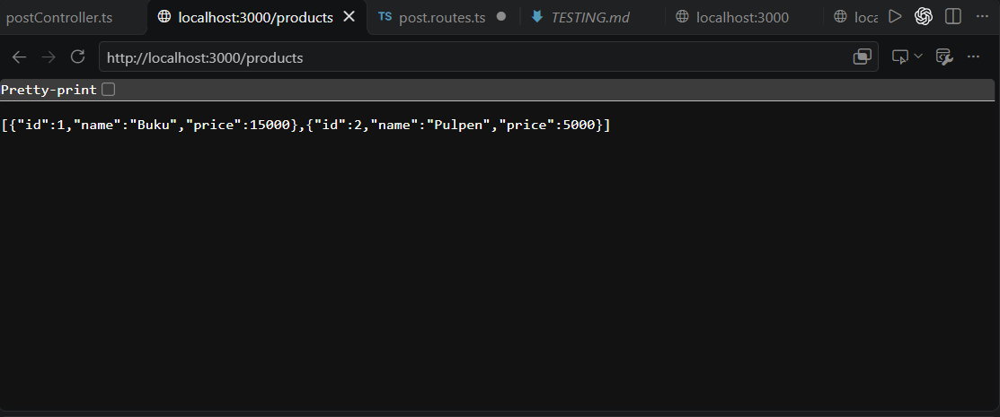
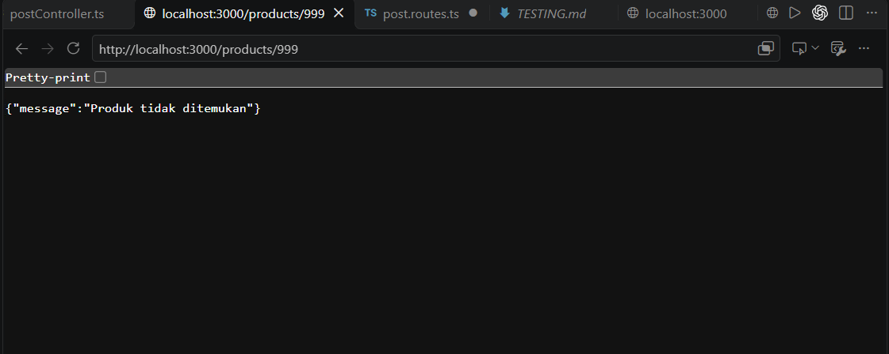
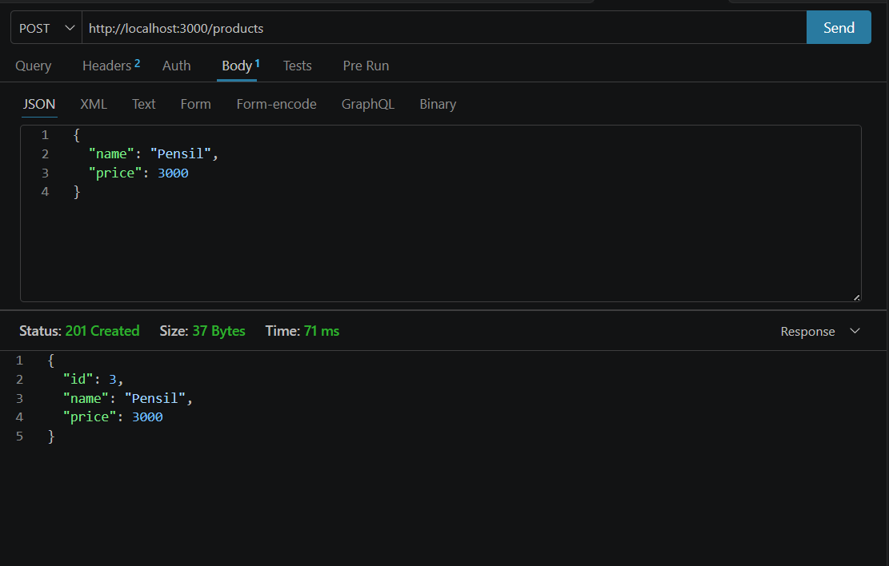
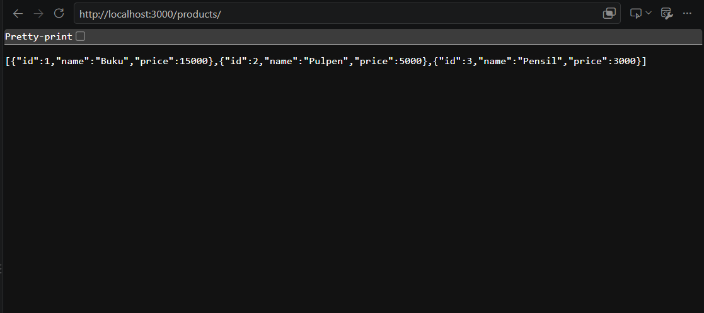

# API Daftar Produk

Proyek ini adalah REST API sederhana menggunakan Express.js dan TypeScript. Data produk disimpan di dalam array tanpa database.

## Cara Menjalankan

Pastikan Node.js sudah terpasang, lalu jalankan:

```bash
npm install
npm run dev
```

Server berjalan pada `http://localhost:3000`. Untuk menjalankan versi hasil build:

```bash
npm run build
npm start
```

## Struktur Proyek

```text
src/
├── app.ts
├── index.ts
├── data/
│   └── products.ts
├── controllers/
│   └── product.controller.ts
└── routes/
    └── product.routes.ts
```

Route hanya memasangkan method dan URL ke controller. Controller menangani request, logika pencarian/penambahan data, status HTTP, dan JSON response.

## Daftar Endpoint

| Method | Endpoint | Status berhasil | Keterangan |
|---|---|---:|---|
| GET | `/products` | 200 | Mengambil semua produk |
| GET | `/products/:id` | 200 | Mengambil satu produk berdasarkan ID |
| GET | `/products/:id` | 404 | ID produk tidak ditemukan |
| POST | `/products` | 201 | Menambahkan produk baru |

### Contoh POST

Request:

```json
{
  "name": "Pensil",
  "price": 3000
}
```

Response `201 Created`:

```json
{
  "id": 3,
  "name": "Pensil",
  "price": 3000
}
```

Jika `name` atau `price` tidak valid, API mengembalikan `400 Bad Request`.

## Bukti Pengujian

Pembuktian dilakukan menggunakan browser dan aplikasi pengujian API. Screenshot disimpan di folder `output`.

### 1. GET seluruh produk

Endpoint: `GET /products`

Hasil: `200 OK`



### 2. GET produk yang tidak ditemukan

Endpoint: `GET /products/999`

Hasil JSON: `{"message":"Produk tidak ditemukan"}`

Status yang diharapkan: `404 Not Found`



### 3. POST produk baru

Endpoint: `POST /products`

Data yang dikirim:

```json
{
  "name": "Pensil",
  "price": 3000
}
```

Hasil: `201 Created`



### 4. GET setelah POST

Endpoint: `GET /products`

Produk baru `Pensil` dengan ID `3` berhasil tersimpan di array.


